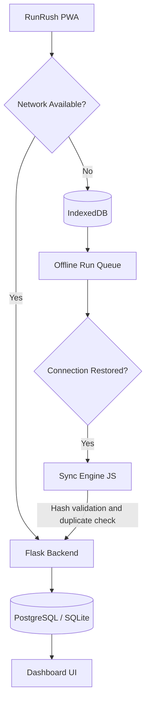
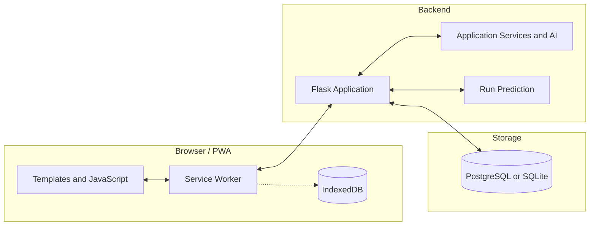

<div align="center">
  
  <h1>RunRush</h1>
  <p><strong>Track. Improve. Repeat.</strong></p>
  <p>A modern, offline-first Progressive Web Application (PWA) for runners who mean business.</p>

  <p>
    
    
    
    
    
    <a href="https://github.com/Yajat-Sharma/Runrush/actions/workflows/python-app.yml"></a>
  </p>
</div>

<p align="center">
  <a href="https://runrush.onrender.com/login"><strong>▶ Open the RunRush live demo</strong></a>
</p>

<p align="center">
  
</p>

<table align="center">
  <tr>
    <td align="center"><br />Login</td>
    <td align="center"><br />Dashboard</td>
    <td align="center"><br />Run logging</td>
  </tr>
</table>

Screenshot files to supply: `docs/assets/login.png`, `docs/assets/dashboard.png`, and `docs/assets/run-logging.png`.

---

## 🏃 About RunRush

RunRush is an offline-first running tracker for logging runs, following progress, and sharing milestones. Its Progressive Web App architecture supports local run logging when the network is unavailable and synchronization when connectivity returns.

---

## ✨ Features

### 🏃 Running & Analytics

- **Activity tracking:** Record distance, duration, pace, and estimated calories.
- **Strava CSV import:** Preview imported runs, detect duplicates, and process the batch transactionally.
- **AI screenshot import:** Upload a screenshot from another running app; the Gemini API extracts run details for review and import.
- **AI run insights:** Generate run feedback from activity details when the configured AI service is available.
- **Weather integration:** Add local weather details to runs when location is configured.
- **Per-user ML prediction:** Estimate a user's next run distance from their history. `GradientBoostingRegressor` is used when there is enough data; smaller histories use a weighted-average fallback.

### 📊 Progress & Gamification

- **Dashboard and analytics:** View run history, charts, a calendar heatmap, goals, and progress indicators.
- **Four-tab dashboard navigation:** Home, Runs, Leaderboard, and Analytics are the four primary in-page tabs.
- **Streaks, goals, and ranks:** Track weekly goals and streaks, earn badges, and progress through distance-based ranks.
- **Leaderboards and social feed:** Follow runners, compare activity, and like runs.

### 📱 PWA & Offline Experience

- **Installable PWA:** Add RunRush to a supported mobile or desktop home screen.
- **Offline run logging:** Store queued runs in IndexedDB while offline.
- **Background synchronization:** Sync queued runs after connectivity returns, with duplicate checks.
- **Service worker caching:** Cache application assets and provide an offline fallback.

### 🔐 User Experience & Security

- **Light and dark themes:** Switch themes and persist a preference across sessions.
- **Authentication and profiles:** Use PIN authentication, profile settings, and Google sign-in when configured.
- **Security protections:** PINs are bcrypt-hashed; Flask-WTF CSRF protection covers state-changing requests with explicit route exemptions; Flask-Limiter rate-limits selected routes.
- **Admin dashboard:** Manage users and review platform activity.

---

## 🔥 The PWA & Offline-First Architecture

RunRush uses a service worker and IndexedDB so users can queue a run while offline and synchronize it when the connection returns.



### Architecture Highlights

- **Service worker:** Caches application resources and handles offline fallback behavior.
- **Offline queue:** Stores runs in IndexedDB until they can be sent to the server.
- **Data integrity:** The sync endpoint checks payload hashes and duplicates before accepting queued runs.

---

## 🏗️ System Architecture



---

## 🛠️ Tech Stack

| Layer | Technology |
| :--- | :--- |
| **Backend** | Python, Flask, Werkzeug, Jinja2 |
| **Frontend** | HTML5, CSS3, Vanilla JavaScript, Bootstrap |
| **Database** | PostgreSQL in production, SQLite for local development |
| **Offline Storage** | IndexedDB, Web Storage API |
| **PWA** | Web App Manifest, Service Worker Cache API |
| **Data Visualization** | Chart.js |
| **ML** | scikit-learn (`GradientBoostingRegressor`), pandas, NumPy |
| **AI** | Google Gemini API (`google-genai`) |
| **Security** | bcrypt, Flask-WTF/CSRF, Flask-Limiter |
| **CI** | GitHub Actions |
| **Deployment** | Gunicorn on Render |

---

## 📂 Project Structure

```text
RunRush/
├── .claude/launch.json
├── .env.example
├── .github/workflows/python-app.yml
├── .gitattributes
├── .gitignore
├── .python-version
├── LICENSE
├── pytest.ini
├── README.md
├── app.py
├── config.py
├── db.py
├── docs/
│   ├── archive/
│   │   ├── RUNRUSH_CODEBASE_AUDIT.md
│   │   ├── RunRush_Project_Report.html
│   │   ├── STEP4_INVESTIGATION.md
│   │   ├── database-compatibility-audit.md
│   │   ├── database-migration-map.md
│   │   └── improvements-history.md
│   ├── assets/
│   │   └── .gitkeep
│   ├── deployment.md
│   ├── developer-guide.md
│   └── project-summary.md
├── extensions.py
├── gunicorn.conf.py
├── marketing/
│   ├── runrush-qr-card.png
│   ├── runrush-qr.png
│   └── runrush-qr.svg
├── migrations/
│   ├── 001_initial_schema.sql
│   ├── 002_seed_badges_challenges.sql
│   ├── 003_add_user_onboarding_fields.sql
│   ├── 004_add_monthly_goals.sql
│   ├── 005_add_profile_emoji.sql
│   ├── 006_add_notifications.sql
│   ├── 007_add_monthly_summary_deliveries.sql
│   ├── 008_add_run_likes.sql
│   ├── 009_drop_user_pets.sql
│   └── README.md
├── ml_predictor.py
├── models/
│   ├── __init__.py
│   └── user.py
├── requirements-dev.txt
├── requirements.txt
├── schema.sql
├── scripts/
│   ├── add_dummies.py
│   ├── apply_migration_006.py
│   ├── apply_migration_008.py
│   ├── apply_migration_009.py
│   ├── delete_user.py
│   ├── migrate_to_pg.py
│   └── smoke_script.py
├── services/
├── static/
│   ├── css/
│   ├── fonts/
│   ├── icons/
│   ├── img/
│   ├── js/
│   ├── manifest.json
│   └── sw.js
├── templates/
├── tests/
└── utils/
    ├── __init__.py
    ├── dates.py
    ├── decorators.py
    ├── rate_limiter.py
    └── validators.py
```

---

## 📱 Installation (PWA)

- **Android (Chrome):** Open RunRush and choose the install prompt or select **Install app** from the browser menu.
- **iOS (Safari):** Tap **Share**, then **Add to Home Screen**.
- **Desktop (Chrome/Edge):** Use the install icon in the address bar when available.

---

## 💻 Local Development

RunRush uses SQLite for local development.

```bash
git clone https://github.com/Yajat-Sharma/Runrush.git
cd Runrush
python -m venv .venv
# Windows: .venv\Scripts\activate
# macOS/Linux:
source .venv/bin/activate
pip install -r requirements-dev.txt
```

Copy `.env.example` to `.env` and set the required local values, including a `SECRET_KEY`. Then start the app:

```bash
python app.py
```

The development server is available at `http://localhost:5000`.

---

## 🌍 Deployment

See [the Render deployment guide](docs/deployment.md) for service settings, database configuration, and the SQLite-to-PostgreSQL migration command.

---

## 🔒 Security & Reliability

- PINs are hashed with bcrypt.
- Flask-WTF CSRF protection is enabled, with explicit exemptions for selected endpoints.
- Flask-Limiter applies limits to selected sensitive routes.
- Backend validation checks submitted run data.
- Offline synchronization uses payload hashing and duplicate checks.

---

## 🗺️ Roadmap

### ✅ Completed

- Core run tracking and analytics
- Offline-first PWA architecture and background sync
- Four-tab dashboard navigation and light/dark theme system
- Global leaderboards, social feed, run likes, and distance-based ranks
- Strava CSV import and Gemini-powered screenshot import
- Per-user next-run distance prediction with a small-data fallback
- bcrypt PIN hashing, CSRF protection, and rate limiting
- GitHub Actions CI workflow

### 🚧 Planned

- Advanced training plans
- Direct OAuth integration with Strava/Garmin
- Granular heart-rate zone analysis
- Weekly team challenges

---

## 📚 Documentation

- [Deployment guide](docs/deployment.md)
- [Developer guide](docs/developer-guide.md)
- [Archived documentation](docs/archive/)
- [Project summary](docs/project-summary.md)

---

## Contributing

Contributions are welcome. Fork the repository, create a feature branch, commit your changes, and open a pull request.

<div align="center">
  <p>Built with ⚡ by <strong>Yajat Sharma</strong></p>
</div>
